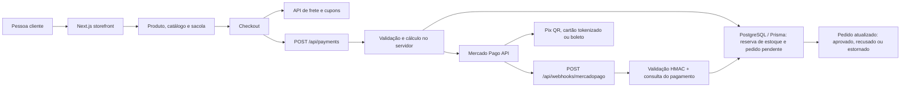

# Atenas Fitness

Loja virtual mobile-first de moda fitness e acessórios. O storefront usa Next.js App Router, TypeScript e Tailwind CSS; a API server-side usa PostgreSQL com Prisma e Mercado Pago.

## Arquitetura

### Fluxo do pedido

1. A pessoa escolhe tamanho/cor, calcula uma estimativa de frete e adiciona à sacola.
2. O checkout coleta contato e entrega, valida cupom e apresenta Pix, cartão ou boleto.
3. `POST /api/payments` consulta variantes e preços atuais no PostgreSQL, calcula desconto/frete no servidor e reserva estoque atomicamente; não aceita preço enviado pelo navegador.
4. O Mercado Pago cria o pagamento com a chave de idempotência do checkout. Para cartões, o SDK oficial transforma os dados em token no navegador: número e CVV não passam pela nossa API.
5. O Pix apresenta QR e código copia-e-cola; o cartão suporta até seis parcelas, conforme emissor; o boleto exibe PDF e linha digitável quando fornecidos pelo provedor.
6. O webhook valida `x-signature` com HMAC em tempo constante, consulta novamente o pagamento no Mercado Pago, compara moeda/valor/pedido e grava o evento com chaves únicas. Eventos repetidos são reconhecidos; transições antigas não reabrem pedidos aprovados ou estornados.
7. Recusa ou cancelamento libera o estoque apenas uma vez. Aprovação, cancelamento e estorno atualizam o pedido no banco.

## Executar localmente

Requisitos: Node.js 22+, npm e uma instância PostgreSQL acessível.

Prisma 7 usa o adaptador PostgreSQL `@prisma/adapter-pg`; para migrações locais, a URL de conexão fica em `POSTGRES_URL` no ambiente de execução do comando. O build gera o client sem precisar acessar o banco.

1. Configure `POSTGRES_URL` com a URL da instância PostgreSQL no ambiente local e no ambiente de execução.
2. Configure as credenciais de runtime `MP_ACCESS_TOKEN` e `MP_WEBHOOK_SECRET`; configure também a chave pública `NEXT_PUBLIC_MP_PUBLIC_KEY` para ativar o brick de cartão. `APP_BASE_URL` precisa apontar para a origem HTTPS pública usada pelos webhooks e metadados.
3. Aplique schema e dados de demonstração: `npm run db:migrate` e `npm run db:seed`.
4. Instale dependências e inicie: `npm ci` e `npm run dev`.
5. Para build de produção: `npm run build` e `npm start`.

Os valores de exemplo não incluem credenciais: configure os nomes acima no ambiente apropriado. Não coloque tokens privados em `NEXT_PUBLIC_*`, arquivos versionados ou logs. O webhook cadastrado no Mercado Pago deve apontar para `/api/webhooks/mercadopago` e usar o mesmo segredo configurado como `MP_WEBHOOK_SECRET`.

## Painel administrativo

O painel fica em `/admin`. Configure `NEXT_PUBLIC_SUPABASE_URL`, `NEXT_PUBLIC_SUPABASE_PUBLISHABLE_KEY`, `NEXT_PUBLIC_VERDENT_OAUTH_INITIATE_URL` e `ADMIN_EMAIL` (`atenasmodafitness@gmail.com`) no ambiente de execução. A pessoa administradora cria sua própria conta, confirma o e-mail e entra pelo botão de login; qualquer outra conta é bloqueada no servidor. A política do bucket de imagens também permite alterações somente para esse mesmo e-mail.

Antes de usar o painel, aplique a migration aditiva `prisma/migrations/0002_catalog_admin/migration.sql` ao PostgreSQL da loja com `npm run db:migrate`. Ela adiciona campos de catálogo e status de variação sem remover registros. A migration Supabase `admin_product_media` cria o bucket público para leitura e restringe escrita à administradora. Defina os campos Supabase e `ADMIN_EMAIL` no ambiente de hospedagem antes do primeiro acesso.

## Estrutura

- `src/app`: páginas de início, catálogo, produto, checkout, painel administrativo, SEO, frete, cupons, pagamentos e webhook.
- `src/components`: navegação, sacola lateral, cards, filtros, checkout e painel administrativo.
- `src/lib`: consultas do catálogo no banco, autorização administrativa, acesso ao Prisma, validação do provedor e cotação de frete.
- `prisma/schema.prisma` e `prisma/migrations`: catálogo, variantes/estoque, cupons, pedidos e idempotência de eventos.

## Antes de uma operação comercial

- Substitua o catálogo, imagens, preços, composições, avaliações e estoque demonstrativos por dados próprios; rode `prisma db seed` apenas no banco adequado.
- O frete atual consulta o ViaCEP e usa uma tarifa estimada por região; substitua essa regra por uma cotação real de transportadora e valide a política de entrega antes de vender.
- Configure as credenciais de produção, notificação/webhook HTTPS e os meios de pagamento habilitados na conta Mercado Pago. Faça testes end-to-end em sandbox e confirme aprovação, recusa, expiração e estorno antes de abrir o checkout.
- Defina controles operacionais adicionais de produção: limitação de tentativas, alertas/monitoramento, reconciliação de pedidos, backups e política LGPD de retenção/eliminação de dados pessoais.
- A aplicação usa PostgreSQL externo em vez do banco gerenciado Verdent. A URL é segredo de runtime; escolha um provedor com rede acessível ao container, backups, monitoramento e política de disponibilidade adequados. Para persistência gerenciada pelo Verdent, avalie migrar para o Verdent Supabase antes de produção.
